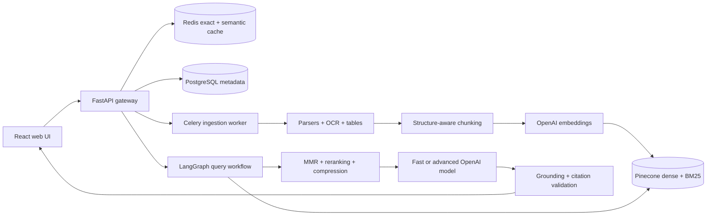

# Application Walkthrough
Video:https://youtu.be/3790Akpe55k

# Advance RAG

A production-oriented, evidence-first Retrieval-Augmented Generation platform for local use. It ingests heterogeneous documents, stores dense and BM25 sparse vectors in Pinecone, performs adaptive hybrid retrieval, routes simple and complex questions to configurable OpenAI models, validates claim-level citations, and refuses to answer when the indexed evidence is insufficient.

The complete application is available locally at **http://localhost:8000**.

For the full Windows setup, testing, operations, and troubleshooting walkthrough, see [SETUP.md](SETUP.md).

## Architecture



The main query path is:

```text
Exact cache → deterministic route → semantic cache → optional query transformation
→ parallel dense and BM25 retrieval → RRF/weighted fusion → MMR → reranking
→ answerability gate → deterministic fallback OR grounded generation
→ claim/citation validation → validated SSE response → cache + metrics
```

## Features

- PDF, scanned PDF, TXT, Markdown, DOCX, CSV, JSON, HTML/web, PNG, JPEG, TIFF, and WebP ingestion.
- PDF page tracing, DOCX heading hierarchy, nested JSON paths, table-aware Markdown, embedded-image OCR, and rich Pinecone metadata.
- Recursive, token, sentence, semantic-boundary, structure-aware, and parent-child chunking.
- Batch OpenAI embeddings with content-hash caching and dimension validation.
- Pinecone serverless index creation, namespaces, dense vectors, BM25 sparse vectors, metadata filters, updates, and deletes.
- Query classification, rewriting, expansion, decomposition, multi-query retrieval, RRF, weighted fusion, MMR, local or Cohere reranking, and contextual compression.
- Configurable fast and advanced OpenAI model tiers using the Responses API and strict JSON-schema output.
- Deterministic no-answer response before generation when retrieval confidence is low.
- Claim-level source enforcement and a stricter single regeneration when grounding fails.
- Exact, semantic, and embedding caches in Redis with knowledge-base/configuration version keys.
- React dashboard for ingestion, document lifecycle, grounded chat, citations, evaluation, and dependency health.
- JSON logs, request IDs, Prometheus metrics, stage timings, token accounting, and cost fields.
- RAGAS, DeepEval, Hit Rate, MRR, NDCG, token-F1, fallback rate, cache rate, and P50/P95 latency reports.
- First-class bid packages, folder/multi-file import, RFP metadata filters, 20-field extraction, addendum reconciliation, validation traces, and canonical JSON downloads.

## Prerequisites

- Docker Desktop with Docker Compose.
- An OpenAI API key with access to the models configured in `.env`.
- A Pinecone API key. The application creates the configured serverless index when `PINECONE_AUTO_CREATE=true`.
- Approximately 6 GB of free disk space for images, PostgreSQL/Redis volumes, OCR tools, and the local reranker model.

The host Python and Node installations are optional when using Docker. The containers use Python 3.11 and Node 22.

## Quick start on Windows

1. Open PowerShell in this directory.
2. Create the private environment file:

   ```powershell
   Copy-Item .env.example .env
   ```

3. Edit `.env` and set only your real keys:

   ```dotenv
   OPENAI_API_KEY=your_openai_key
   PINECONE_API_KEY=your_pinecone_key
   ```

4. Start the application:

   ```powershell
   docker compose up --build
   ```

5. Open:

   - Web application: http://localhost:8000
   - OpenAPI documentation: http://localhost:8000/docs
   - Readiness: http://localhost:8000/ready
   - Prometheus metrics: http://localhost:8000/metrics

   When `APP_API_KEY` is configured, paste only that application key into **Local API key** in the web sidebar and select **Connect**. The UI keeps it in browser session storage and attaches it to protected requests. Never enter OpenAI or Pinecone credentials in the browser.

Alternatively, run `./scripts/start.ps1`; it validates that `.env` and both keys exist before starting Compose.

Do not paste real keys into source files and never commit `.env`.

## Pinecone configuration

The default setup creates a serverless `advance-rag` index in AWS `us-east-1` using dot-product similarity and `EMBEDDING_DIMENSIONS=3072`. Each chunk contains both an OpenAI dense vector and a BM25 sparse vector. Knowledge bases are isolated in `kb-<knowledge_base_id>` namespaces.

Changing the embedding model or dimension requires a new compatible Pinecone index name. The readiness endpoint rejects a dimension mismatch instead of corrupting the index.

To validate credentials and provision the index explicitly:

```powershell
docker compose run --rm api python -m scripts.bootstrap
```

## Model and retrieval configuration

The defaults are examples and may be changed to models available to your OpenAI account:

```dotenv
FAST_MODEL=gpt-6-luna
ADVANCED_MODEL=gpt-6.1-sol
EMBEDDING_MODEL=text-embedding-3-large
EMBEDDING_DIMENSIONS=3072
RERANKER_PROVIDER=local
RERANKER_MODEL=BAAI/bge-reranker-base
```

`RERANKER_PROVIDER` accepts `local`, `lexical`, or `cohere`. Cohere requires `COHERE_API_KEY`. The local model downloads once into the persistent `model_cache` volume.

Retrieval breadth, fusion balance, MMR, confidence gates, cache thresholds, chunk sizes, context limits, output limits, and retries are all documented in `.env.example`.

## RFP intelligence workflow

The assignment source directory remains read-only. Import its immediate bid subfolders from the host so the Docker API receives each file as an upload; root files such as the assignment PDF are deliberately ignored:

```powershell
.\.venv\Scripts\python.exe -m app.cli ingest-folder `
  --path "C:\Users\sinha\Downloads\Statements (AI Engineer-Emplay Inc)\Assignment-Data-Statements (AI Engineer-Emplay Inc)"
```

The import creates independent `Bid1` and `Bid2` records in knowledge base `rfp-intelligence` and Pinecone namespace `kb-rfp-intelligence`. It is idempotent: existing bid records are reused and document hashes prevent duplicate versions.

After every document is active, compare the retrieval modes:

```powershell
docker compose run --rm api python -m evaluation.retrieval_benchmark `
  --dataset evaluation/datasets/rfp_retrieval.json `
  --output outputs/reports/rfp-retrieval-comparison.json
```

Run extraction from the **RFP bids** page or CLI:

```powershell
.\.venv\Scripts\python.exe -m app.cli extract --bid-id Bid1
.\.venv\Scripts\python.exe -m app.cli extract --bid-id Bid2
```

Canonical records are persisted at `outputs/bids/Bid1.json` and `outputs/bids/Bid2.json`. Every supported value carries file, page, chunk, and quote evidence; unsupported fields are `null` with a reason. The UI exposes the field results, addendum history, validation status, extraction progress, citation inspection, and JSON download.

Validate all 40 bid fields and generate the live sync/SSE Q&A evidence:

```powershell
docker compose run --rm api python -m evaluation.extraction_benchmark
docker compose run --rm api python -m scripts.rfp_sample_qa `
  --limit 10 `
  --output outputs/reports/rfp-sample-qa.json
docker compose run --rm api python -m scripts.rfp_sample_qa `
  --negative-only --limit 1 --max-attempts 1 `
  --output outputs/reports/rfp-negative-control.json
```

These reports check the 20-field contract for each bid, citation coverage, deterministic no-answer behavior, and equality of synchronous and SSE answers/status/citations. Redacted stage traces are saved under `outputs/traces`.

Raw bid-aware search is available at `POST /api/v1/search` and through:

```powershell
.\.venv\Scripts\python.exe -m app.cli search `
  --bid-id Bid1 `
  --mode hybrid_rerank `
  --query "What is the final proposal due date?"
```

## Document ingestion

Use the web UI or the REST API:

```powershell
$appKey = ((Get-Content .env | Where-Object { $_ -match '^APP_API_KEY=' }) -replace '^APP_API_KEY=', '').Trim()
curl.exe -X POST "http://localhost:8000/api/v1/documents/upload?knowledge_base_id=default" `
  -H "X-API-Key: $appKey" `
  -F "file=@examples/documents/refund_policy.txt"
```

The response contains a `job_id`. Check progress at:

```text
GET /api/v1/documents/jobs/{job_id}
```

Web ingestion accepts public HTTP/HTTPS URLs. Local, private, link-local, reserved, credential-bearing, and redirect-based SSRF destinations are blocked.

Updating a document creates a new version. Unchanged chunk embeddings are reused from Redis; the current document records are atomically replaced in the Pinecone namespace and the knowledge-base cache version is incremented.

## Querying

Synchronous example:

```powershell
$appKey = ((Get-Content .env | Where-Object { $_ -match '^APP_API_KEY=' }) -replace '^APP_API_KEY=', '').Trim()
$Body = @{ query = 'What is the refund period?'; knowledge_base_id = 'default' } | ConvertTo-Json
Invoke-RestMethod -Method Post -Uri http://localhost:8000/api/v1/query `
  -Headers @{ 'X-API-Key' = $appKey } `
  -ContentType application/json -Body $Body
```

If `APP_API_KEY` is blank, omit the header. In PowerShell, use `ConvertTo-Json` for request bodies; passing a hashtable directly to `curl.exe` is not valid JSON and causes a JSON decode error.

The response contains:

```json
{
  "answer": "Customers may request a refund within 30 calendar days.",
  "status": "answered",
  "confidence": 0.91,
  "citations": [{"document": "refund_policy.txt", "chunk_id": "..."}],
  "route": "SIMPLE_RAG",
  "model_used": "...",
  "cache_hit": false,
  "retrieval_metadata": {},
  "latency_ms": {},
  "token_usage": {},
  "request_id": "..."
}
```

`POST /api/v1/query/stream` emits `status`, `answer_delta`, `citation`, `done`, and `error` SSE events. The server buffers and validates the structured generation before releasing answer deltas, preventing an unsupported draft from reaching the client.

When evidence remains inadequate after one configured retrieval retry, the API returns:

```text
I couldn't find this information in the provided documents.
```

No generation request is made on that path.

## Evaluation

First ingest `examples/documents/refund_policy.txt`, then run:

```powershell
docker compose run --rm api python -m evaluation.run `
  --dataset evaluation/datasets/example.json `
  --knowledge-base default
```

JSON and HTML reports are written to the persistent `reports` volume. RAGAS and DeepEval run when their evaluation dependencies and judge-model credentials are available; native retrieval, answer, latency, cache, and token metrics always run.

For the manually verified, 16-question bid retrieval benchmark, run:

```powershell
docker compose run --rm api python -m evaluation.retrieval_benchmark `
  --dataset evaluation/datasets/rfp_retrieval.json `
  --output reports/rfp-retrieval-comparison.json
```

This compares dense-only, hybrid, and hybrid-plus-reranking retrieval and reports Recall@5, MRR, and nDCG for both bid packages.

Dataset format:

```json
[
  {
    "question": "What is the refund period?",
    "expected_answer": "30 calendar days",
    "expected_sources": ["refund_policy.txt"]
  }
]
```

## Tests and quality gates

Run unit tests inside the application image:

```powershell
docker compose run --rm api pip install -e '.[dev]'
docker compose run --rm api pytest -m "not live and not integration" --cov=app --cov-report=term-missing
```

Run static checks:

```powershell
docker compose run --rm api ruff check app tests evaluation
docker compose run --rm api ruff format --check app tests evaluation
docker compose run --rm api mypy app evaluation
```

Run live credentialed checks:

```powershell
docker compose run --rm api pytest -m live -v
```

Run frontend checks:

```powershell
cd frontend
node "D:\DeskRest\nodejs\node_modules\npm\bin\npm-cli.js" run lint
node "D:\DeskRest\nodejs\node_modules\npm\bin\npm-cli.js" test
node "D:\DeskRest\nodejs\node_modules\npm\bin\npm-cli.js" run build
$env:PLAYWRIGHT_BASE_URL = "http://localhost:8000"
node "D:\DeskRest\nodejs\node_modules\npm\bin\npm-cli.js" run test:e2e
Remove-Item Env:PLAYWRIGHT_BASE_URL
cd ..
```

The Playwright browser is installed once with `node node_modules/playwright/cli.js install chromium`.
The Compose Redis service enables append-only persistence so exact, semantic, and embedding cache
state survives a normal stop/start. The first local run with blank keys is intentionally
infrastructure-only: `/health` is 200, while `/ready` reports `missing_key` for OpenAI and Pinecone.
After adding credentials to `.env`, restart Compose and run the live tests and evaluation commands.

The GitHub Actions workflow separately runs frontend lint, component tests, production build, backend tests, type checks, and the container build. Live external tests remain opt-in because CI secrets are not assumed.

## Security and reliability

- API keys and service credentials come only from environment variables.
- Optional `APP_API_KEY` protects application endpoints through `X-API-Key`.
- Uploads are size-limited, signature-checked, extension-checked, and stored under generated document IDs.
- Web ingestion resolves every destination and redirect before connecting.
- Retrieved text is always framed as evidence, never as instructions.
- Every generated factual claim must reference an actually retrieved chunk.
- Logs redact secret-like fields and store a query hash instead of raw query text in PostgreSQL.
- External calls use bounded timeouts/retries; cache/rate-limit degradation does not silently fabricate answers.

For internet-facing deployment, place the API behind TLS, set `APP_API_KEY`, restrict `ALLOWED_ORIGINS`, use a secret manager, enable Pinecone deletion protection after provisioning, replace local file storage with an object-store adapter, and connect Prometheus/logs to your monitoring platform.

## Operations

View logs:

```powershell
docker compose logs -f api worker
```

Stop while preserving data:

```powershell
docker compose down
```

Rebuild after code or dependency changes:

```powershell
docker compose up --build
```

Remove local PostgreSQL, Redis, uploads, reports, and model-cache volumes only when you intentionally want a clean reset:

```powershell
docker compose down --volumes
```

This does not delete the managed Pinecone index. Delete Pinecone data through the document API or the Pinecone console only when intended.

## Troubleshooting

- **`/ready` reports `missing_key`**: add the key to `.env`, then restart the API and worker.
- **Pinecone dimension mismatch**: use an index created for the configured embedding dimension or choose a new `PINECONE_INDEX`.
- **OCR fails**: confirm the Docker image built successfully with Poppler and Tesseract; add language packages and update `OCR_LANGUAGES` for non-English documents.
- **Worker jobs stay queued**: check `docker compose logs worker redis` and confirm the worker uses the same `.env` and volumes as the API.
- **First query is slow**: the local cross-encoder is downloaded and loaded on first use. The persistent model volume makes subsequent starts faster.
- **A question receives the fallback**: inspect retrieval scores and citations, tune thresholds using the evaluation dataset, or add documents that explicitly contain the requested information.
