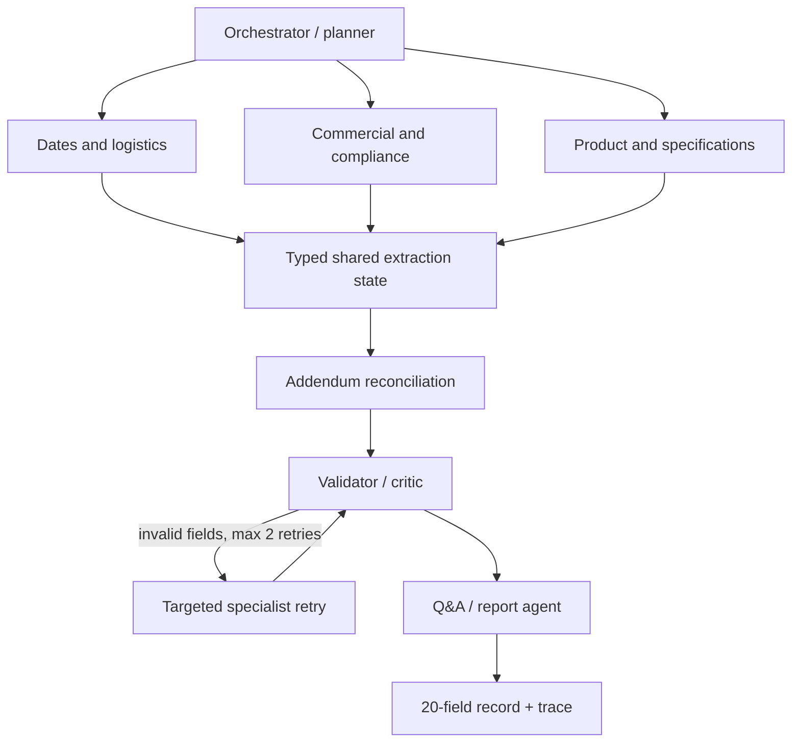

# RFP Intelligence Architecture

```mermaid
flowchart LR
    Folder[Bid folder or multi-file upload] --> Registry[Bid registry]
    Registry --> Parse[Page/table/OCR parser]
    Parse --> Clean[Header/footer and line repair]
    Clean --> Chunk[Page-aware structured chunks]
    Chunk --> Index[(Pinecone kb-rfp-intelligence)]
    Chunk --> Lifecycle[(PostgreSQL lifecycle)]
    Search[Bid-aware search API/CLI] --> Index
    Index --> Fusion[Dense + BM25 fusion]
    Fusion --> Rerank[MMR and reranking]
    Rerank --> Agents[Parallel extraction specialists]
    Agents --> Reconcile[Addendum reconciliation]
    Reconcile --> Validate[Validator and bounded retries]
    Validate --> Record[Canonical bid JSON]
    Record --> UI[React result/citation UI]
    Rerank --> QA[Grounded Q&A]
    QA --> UI
```

## Agent communication

Each specialist receives only retrieved passages and returns Pydantic-validated field results. Branch failures are recorded and isolated; the validator retries only affected fields. Every supported value must include a source file and chunk ID, while page and quotation are preserved when available.
