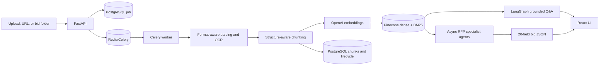
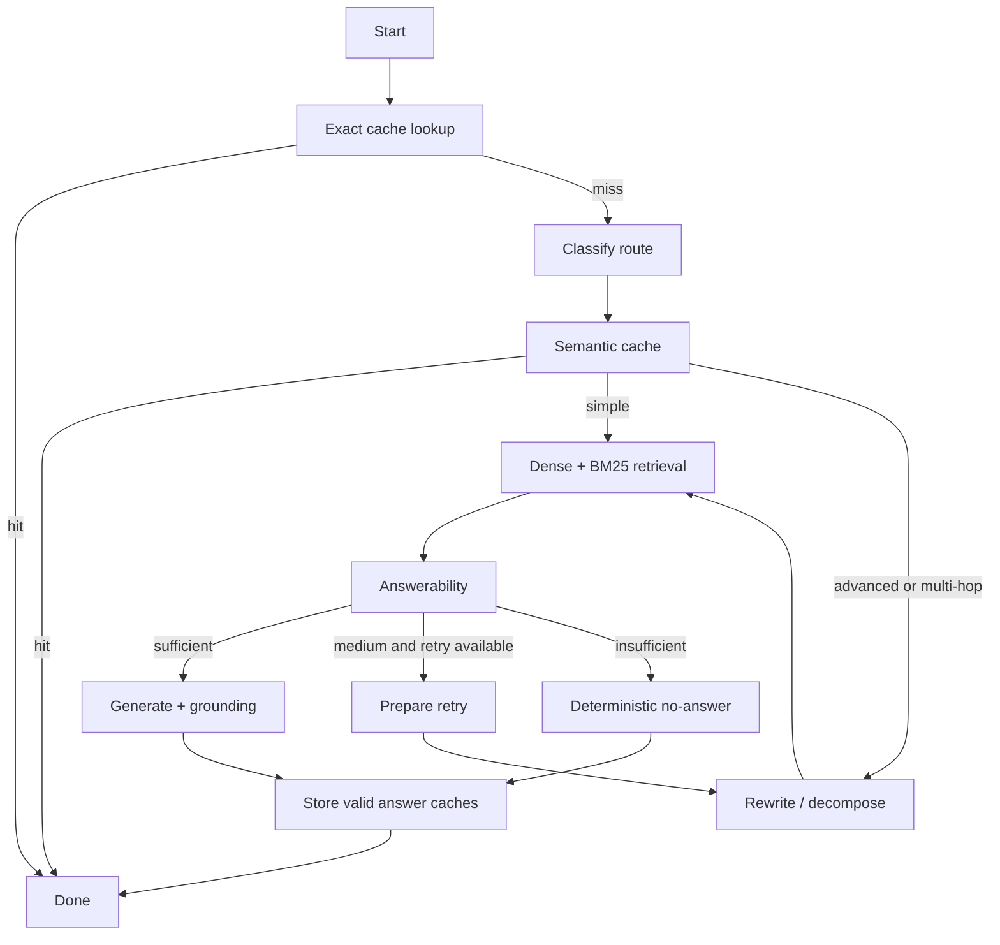
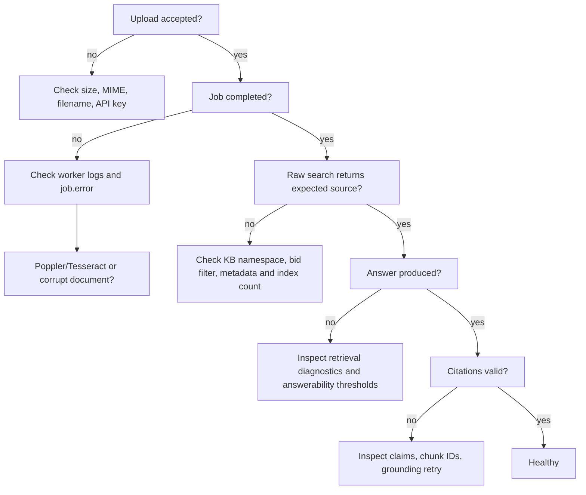

# Advance RAG and RFP Intelligence Platform: Complete System Guide

This document explains the application as it is implemented. It is intended both as a code map and as preparation for explaining the project in a technical interview. File and line references are snapshots of the cleaned codebase on 24 October 2026; prefer the named class or function if later edits move the line numbers.

## 1. What this application actually does

The repository contains two connected products that share the same ingestion, embedding, vector-storage, retrieval, citation, security, and observability foundations.

1. **General grounded RAG:** a user uploads a document or submits a public URL, waits for background ingestion, and asks questions. The system retrieves evidence, decides whether the evidence is answerable, generates a structured answer, validates every claim, and returns citations. This request pipeline is a real LangGraph state graph.
2. **RFP intelligence:** a user imports a folder containing one or more bid packages. Each package becomes an independent bid. The system retrieves evidence for 20 required procurement fields, runs specialist extraction agents concurrently, reconciles explicit addendum changes, validates the record, retries only failed fields, and writes a canonical cited JSON file.

### 1.1 What Bid1 and Bid2 mean

Bid1 and Bid2 are the two supplied example procurement packages. They are not two algorithms and their facts are not hardcoded into the application.

- Each folder contains documents that jointly describe one procurement opportunity: RFP pages, bid portal exports, product specifications, affidavits, and/or addenda.
- Folder discovery in `app/api/bids.py:248-319` creates a `Bid` record for each child directory and ignores the assignment PDF at the parent level.
- Every imported document receives the bid UUID in its metadata. Retrieval for a selected bid applies `{"bid_id": {"$eq": "..."}}`, preventing evidence from another bid from leaking into the answer.
- Both bids use the same parsers, chunker, index, retriever, and agents. Their purpose is to prove that the system is data-driven and can ingest a future folder without changing code.
- Addenda matter because a later addendum may replace an original date or requirement. The reconciliation stage applies only explicit changes and preserves the original/revised audit history.

### 1.2 What “multi-agent” means here

The RFP extraction workflow has logical agents with separate responsibilities, inputs, and structured outputs. Three specialist agents run concurrently; reconciliation, validation, retry, and reporting follow them. They share typed state through Python/Pydantic objects and the database.

Important accuracy point: **the conversational Q&A workflow uses LangGraph; the RFP extraction workflow is asynchronous multi-agent orchestration implemented with `asyncio.gather`, not a LangGraph graph.** See `RAGEngine._build_graph()` in `app/query/graph.py:394-427` and `run_extraction()` in `app/rfp/extraction.py:387-645`.



## 2. Runtime architecture and data ownership

### 2.1 Services

| Component | Responsibility | Main code |
|---|---|---|
| FastAPI | REST endpoints, SSE, auth/rate-limit dependencies, SPA hosting | `app/main.py`; `app/api/` |
| Celery worker | Ingestion, saved evaluation, and extraction jobs | `app/worker.py:31-78` |
| PostgreSQL | Documents, versions, chunks, jobs, bids, logs, extraction runs, agent steps | `app/models.py:27-219`; `app/db.py` |
| Redis DB 0 | Exact answers, semantic answers, embeddings, KB versions, rate-limit state | `app/cache/service.py:24-164` |
| Redis DB 1/2 | Celery broker messages and results | `app/config.py:45-47`; `docker-compose.yml` |
| Pinecone | Dense vectors, BM25 sparse vectors, searchable text, retrieval metadata | `app/vectorstore/pinecone.py:16-203` |
| OpenAI | Embeddings, query transformation, structured answers, extraction agents | `app/embeddings/openai.py`; `app/generation/service.py`; `app/rfp/agents.py` |
| React/Vite | Document, bid, extraction, chat, evaluation, and health interface | `frontend/src/App.tsx`; `frontend/src/BidsPage.tsx` |

All shared services are constructed once by `Services` in `app/services.py:16-85`. That class wires settings into the Redis cache, embedder, Pinecone adapter, reranker, hybrid retriever, transformer, generator, and LangGraph engine.

### 2.2 Storage matrix

| Store | What is stored | Why it belongs there |
|---|---|---|
| Managed document volume | Original uploaded files copied under a document/version path | Parsers require durable bytes; originals in Downloads remain untouched. |
| PostgreSQL | Lifecycle state, document versions, complete chunk text, metadata, jobs, query logs, bid/extraction records, traces | Transactional source of truth and relational joins. It also supports adjacent-chunk expansion. |
| Pinecone | Vector ID, dense vector, sparse BM25 values, text (up to 30,000 characters), page/source/bid metadata | Low-latency semantic and lexical retrieval with server-side metadata filtering. |
| Redis | Exact/semantic responses, embeddings, KB generation counters, broker/result data | Short-lived high-speed data whose loss does not destroy the knowledge base. |
| `outputs/bids` | Human/automation-consumable canonical bid JSON | Submission artifact and portable result. |
| `outputs/traces` | Redacted extraction execution trace | Debugging and auditability. |
| `outputs/reports` | Retrieval, extraction, Q&A, negative-control, and coverage reports | Quality evidence, not runtime state. |

The Pinecone namespace is derived as `kb-{knowledge_base_id}` in `app/ingestion/pipeline.py:140-142`. General documents use `kb-default`; assignment bids use `kb-rfp-intelligence`.

## 3. Ingestion: from request to indexed document

### 3.1 Entry paths

The application supports four ingestion entry paths:

- `POST /api/v1/documents/upload` — one uploaded file (`app/api/documents.py:155-173`).
- `POST /api/v1/documents/ingest` — a public URL fetched with SSRF protection (`app/api/documents.py:175-213`).
- `POST /api/v1/bids/{bid_key}/documents` — multiple files assigned to an existing bid (`app/api/bids.py:211-244`).
- `POST /api/v1/bids/import-folder` — discovers arbitrary child bid folders and copies supported files (`app/api/bids.py:247-319`).

All file paths converge on `persist_upload()` in `app/api/documents.py:51-152`. It:

1. Normalizes the filename and validates the detected MIME type.
2. Computes SHA-256 for duplicate detection.
3. Scopes duplicates by knowledge base and bid, so identical bytes in two bids do not merge incorrectly.
4. Creates or updates `Document` and `DocumentVersion` records.
5. Copies the bytes into managed storage.
6. Creates an `IngestionJob` with `queued` state.
7. Enqueues `advance_rag.ingest_document` through Celery.

Document versions are retained instead of overwriting history. Re-ingesting a changed source creates a new version; indexing deletes that document's old vectors before upserting the new version.

### 3.2 Worker execution

Celery task functions are in `app/worker.py:61-78`. The worker uses the `solo` pool in Docker because model/async clients are safer without prefork process state. `ingest_document_task()` calls the async `ingest_document()` pipeline in an isolated event loop.

The ingestion state progression is visible through `/api/v1/documents/jobs/{job_id}`:

```text
queued -> loading -> parsing -> chunking -> embedding -> indexing -> persisting -> completed
                                                                      \-> failed
```

The percentages and status changes are written by `_update_job()` in `app/ingestion/pipeline.py:30-38`.

### 3.3 Security before parsing

- `safe_filename()` in `app/security/files.py:27-33` strips paths and unsafe characters.
- `detect_mime()` in `app/security/files.py:35-67` compares extension, magic bytes, and declared type against allowed formats.
- Upload size is limited by `MAX_UPLOAD_MB` (`app/config.py:52`).
- `validate_public_url()` in `app/security/web.py:12-38` accepts only HTTP(S), resolves DNS, and rejects loopback, private, link-local, multicast, and reserved addresses.
- `fetch_public_document()` in `app/security/web.py:41-62` applies redirect, timeout, and download-size limits.
- `sanitize_document_text()` in `app/security/prompts.py:19-23` marks likely prompt-injection content as untrusted evidence; prompts separately instruct models never to follow document instructions.

## 4. Parsing techniques by format

Every parser produces the same intermediate contract from `app/ingestion/types.py:8-39`:

```python
@dataclass(slots=True)
class ParsedElement:
    text: str
    content_type: str = "text"
    page_number: int | None = None
    section: str | None = None
    heading: str | None = None
    table_id: str | None = None
    image_id: str | None = None
    metadata: dict[str, Any] = field(default_factory=dict)
```

This intermediate representation is why chunking does not need separate PDF, HTML, and DOCX implementations. The parser preserves structure; the chunker consumes structure.

`ParserRegistry` in `app/ingestion/parsers.py:517-538` maps file extensions to one parser and rejects unsupported or empty documents.

### 4.1 Text and Markdown

**Code:** `TextParser`, `app/ingestion/parsers.py:134-167`.

- Reads UTF-8 with BOM support and replacement for undecodable bytes.
- Markdown `#` through `######` lines become heading elements.
- Blank lines flush a paragraph, preserving the current heading as `section`.
- Plain TXT therefore becomes paragraph elements; Markdown also retains heading hierarchy.

**How to explain it:** “I normalize text files into typed elements. Markdown headings establish section context, and following paragraphs inherit that context. This lets retrieval return both content and a meaningful section citation.”

### 4.2 JSON

**Code:** `JSONParser`, `app/ingestion/parsers.py:169-210`.

- Recursively walks dictionaries and records the JSON path.
- Scalar values become `path: value` elements.
- Lists are traversed by numeric index.
- A list of objects is treated as a structured table: all keys form headers and rows become Markdown.

The original path is stored in `metadata["json_path"]`, so a retrieved fact remains traceable to its structured location.

### 4.3 CSV

**Code:** `CSVParser`, `app/ingestion/parsers.py:212-247`.

- `csv.Sniffer` detects the delimiter from the first 8 KB; standard CSV is the fallback.
- The first row is always preserved as headers.
- Data is grouped into batches of 50 rows.
- Every batch repeats the headers and stores `row_start`, a table ID, and a human-readable row section.

Fifty-row batching prevents one large CSV from becoming a single oversized chunk while keeping rows intact and understandable.

### 4.4 HTML and downloaded web pages

**Code:** `HTMLParser`, `app/ingestion/parsers.py:249-306`; URL download in `app/security/web.py:41-62`.

- Readability derives the article summary/title for noisy pages.
- BeautifulSoup parses both the readable result and original HTML.
- An original `<article>` or `<main>` is preferred because procurement portal pages can contain useful structured content omitted by readability.
- `h1`-`h4` update section context; paragraphs, list items, and preformatted blocks become text elements.
- HTML tables are converted to Markdown with the first row as headers.
- Downloaded pages use source type `web` and retain `source_url`; uploaded HTML uses `html`.

**How to explain it:** “Readability helps remove navigation noise, but I fall back to semantic containers in the original DOM so tables and portal fields are not lost. I then convert the DOM into the same typed element model used by PDFs and DOCX.”

### 4.5 Images and OCR

**Code:** `ImageParser`, `app/ingestion/parsers.py:308-335`.

- Pillow opens PNG, JPEG, TIFF, and WebP files.
- Tesseract runs with configurable languages (`OCR_LANGUAGES`, default `eng`).
- OCR text becomes an `image_ocr` element with image dimensions and an image ID.
- OCR failure becomes a `DocumentParseError`; an image with no extracted text is rejected by the registry as empty.

### 4.6 DOCX

**Code:** `DOCXParser`, `app/ingestion/parsers.py:337-400`.

- `python-docx` reads paragraphs and style names.
- Title and heading styles become structural headings; ordinary paragraphs inherit the latest section.
- Each Word table becomes a Markdown table with its own `table_id` and headers metadata.
- Because DOCX is a ZIP archive, embedded files under `word/media/` are opened in memory and OCR'd without modifying the source document.
- A corrupt archive is handled conservatively: text/tables remain usable even if embedded-image extraction fails.

### 4.7 PDF: text, pages, cleanup, tables, and OCR

**Code:** `PDFParser`, `app/ingestion/parsers.py:402-515`.

PDF parsing is a layered process rather than one extractor:

1. **Text layer:** `pypdf.PdfReader` extracts page text. If one page throws, that page becomes empty instead of failing the whole document.
2. **Visible page labels:** `extract_pdf_page_label()` (`:29-50`) recognizes an isolated numeric first/last line reasonably close to the physical PDF index. The visible label becomes the citation page; the physical index remains `pdf_page_number` metadata.
3. **Repeated edges:** `remove_repeated_page_edges()` (`:66-105`) normalizes digits in first/last-line signatures and removes headers or footers present on at least 60% of pages.
4. **Line repair:** `clean_extracted_text()` (`:53-63`) joins words split by line-end hyphenation, joins single line breaks inside paragraphs, preserves blank-line paragraph boundaries, and sanitizes untrusted text.
5. **Sparse-page detection:** pages with fewer than 40 extracted characters are queued for OCR.
6. **Tables:** `pdfplumber` independently extracts tables page by page. The first row becomes headers; the element stores both visible and physical page numbers and `pdf-{physical_page}-{table_index}`.
7. **OCR fallback:** only sparse pages are rendered at 250 DPI through `pdf2image`, then sent to Tesseract. This avoids paying OCR cost for pages with usable text.
8. **Partial failure:** table-extraction failure is logged but does not discard text. OCR failure only aborts when no other elements are usable.

**How to explain it:** “A PDF can contain digital text, images, or both, so I use a layered parser. I first preserve page-aware text, clean extraction artifacts, separately recover tables, and OCR only pages that appear text-sparse. This is faster than OCRing everything and preserves accurate citations.”

### 4.8 Table normalization

`table_to_markdown()` in `app/ingestion/parsers.py:108-123` pads short rows, invents names only for missing header cells, escapes pipe characters, and outputs a standard Markdown table. Markdown is used because it is readable by humans, BM25, embeddings, rerankers, and LLMs while preserving row/column relationships.

## 5. Chunking

### 5.1 Available strategies

All strategies live in `app/ingestion/chunking.py` and are selected by `CHUNK_STRATEGY` in `app/config.py:57-61`.

| Strategy | Implementation | Behavior | When it is useful |
|---|---|---|---|
| `recursive` / default window | `_window_text()`, `:25-49` | Character window with overlap; ends near newline/space and realigns the next start to a word boundary | General prose fallback |
| `token` | `_token_window()`, `:52-60` | Approximates four characters per token and creates overlapping word windows | Predictable token-sized input |
| `sentence` | `_sentence_chunks()`, `:63-76` | Accumulates complete sentences until the target size | Narrative text where sentence integrity matters |
| `semantic` | `_semantic_chunks()`, `:91-107` | Compares lexical token vectors of adjacent sentences and splits when similarity is low or size is reached | Topic-change boundaries without an extra embedding call |
| `structure` | `Chunker._split()`, `:116-142` | Uses table-aware splitting for tables and recursive windows for other typed elements | Default and recommended for mixed RFP documents |

The “semantic” strategy here is deliberately lightweight: `_cosine()` at `:79-88` compares word-frequency counters. It is not an embedding-based semantic chunker, so it adds no API cost.

### 5.2 Active default and sizes

Defaults in `app/config.py:57-66` are:

```text
strategy=structure
target size=900 characters
overlap=120 characters
minimum=120 characters
maximum=1600 characters
embedding batch size=64
```

These are character budgets, not exact OpenAI token counts. For English prose, 900 characters is commonly around 180-250 tokens, leaving room to combine several chunks during generation.

### 5.3 Table-aware splitting

In `Chunker._split()` (`app/ingestion/chunking.py:116-142`), a table is split only between rows. The first two Markdown lines—the header and separator—are repeated in every group. This avoids the common failure where retrieval returns a row but loses the column names needed to interpret it.

### 5.4 Parent-child identity and page boundaries

`Chunker.chunk()` (`app/ingestion/chunking.py:144-206`) creates a deterministic parent ID for every parsed element. Child chunks retain that parent ID. Small neighboring chunks may merge only if neither is a table and both have the same page number; content is never merged across PDF pages.

The traceable chunk ID format is:

```text
{document_id}-v{document_version}-{chunk_index}-{first_12_chars_of_content_hash}
```

Chunk metadata merges document-level metadata with page, section, heading, content type, table ID, image ID, and parser-specific metadata. `deduplicate_chunks()` at `:209-216` removes repeated content hashes within the version.

**How to explain it:** “The parser preserves structure, then the default chunker respects that structure. Tables stay row-safe, page citations stay correct, overlapping prose protects boundary facts, and deterministic IDs let every answer trace back to a specific version and source element.”

## 6. Embeddings and Pinecone indexing

The full pipeline is `ingest_document()` in `app/ingestion/pipeline.py:40-213`.

### 6.1 Embedding pipeline

1. The pipeline looks up each chunk embedding by `(content_hash, embedding_model)` in Redis (`app/cache/service.py:129-145`).
2. Only misses are sent to `OpenAIEmbedder.embed_documents()` (`app/embeddings/openai.py:74-80`).
3. `OpenAIEmbedder` batches requests by 64, retries transient OpenAI failures with exponential jitter, and verifies every returned vector has the configured dimension (`:26-92`).
4. New vectors are cached for seven days by default.

The default is `text-embedding-3-large` with 3,072 dimensions (`app/config.py:29-30`). Changing the dimension requires a compatible Pinecone index.

### 6.2 Pinecone upsert

`PineconeVectorStore.initialize()` (`app/vectorstore/pinecone.py:42-65`) creates a serverless cosine index when allowed, waits until it is ready, and rejects a dimension mismatch.

`upsert()` (`:72-101`) stores for each chunk:

- the OpenAI dense vector;
- a sparse vector produced by `BM25Encoder.default().encode_documents()`;
- chunk text, truncated only at Pinecone's metadata-friendly 30,000 characters;
- document, version, source, page, section, heading, content type, table/image IDs, bid ID, document type, addendum number, date, and relative path.

Pinecone vector IDs equal chunk IDs. Upserts are batched in groups of 100. Before a new version is indexed, `delete_document()` (`:179-196`) removes vectors whose `document_id` matches, preventing stale-version retrieval.

### 6.3 Why Pinecone instead of another database?

Pinecone fits this implementation because it offers a managed serverless index, cosine dense vectors, sparse vector queries, metadata filters, namespaces, and no local index process to operate. That is especially useful when the number of bid documents grows beyond a laptop-sized Chroma index.

The choice is a tradeoff, not a universal claim:

| Alternative | Advantage | Why it was not selected here |
|---|---|---|
| ChromaDB | Very simple local development | Local persistence/scaling and production operations become the application's responsibility. |
| PostgreSQL + pgvector | One transactional database and SQL joins | Hybrid sparse retrieval and high-scale vector tuning require more database design/operations. |
| Redis vector search | Very fast and already present | This project uses Redis for ephemeral cache/broker data; making it the durable vector system would mix responsibilities and memory costs. |
| Weaviate/Qdrant/self-hosted | Rich search and control | Adds another stateful production service to deploy, back up, and scale. |
| Pinecone | Managed, serverless, namespaces and filters | Requires internet, a managed-service key, introduces vendor dependency, and costs more than a small local index. |

PostgreSQL remains the lifecycle source of truth; Pinecone is the retrieval index. Redis remains the cache. This separation is intentional.

## 7. Retrieval pipeline

### 7.1 Query routing and cache checks

The public request starts at `POST /api/v1/query` or `/query/stream` (`app/api/query.py:46-109`) and enters `RAGEngine` in `app/query/graph.py:57-438`.

The graph sequence is:



Exact-cache keys include normalized query, knowledge-base version, configuration version, and a hash of the metadata-filter scope (`app/cache/service.py:40-70`; `app/query/graph.py:108-132`). Semantic cache compares the query embedding against up to 250 scoped cached queries and requires cosine similarity of at least 0.93 by default (`app/cache/service.py:72-114`). This scope prevents a cached Bid1 answer from satisfying a Bid2 request.

### 7.2 Classification and transformation

`classify_query()` in `app/query/classifier.py:26-41` uses transparent lexical heuristics:

- direct document identifier questions become `DIRECT_DOCUMENT_LOOKUP`;
- complex markers, length, and clause count choose `ADVANCED_RAG` or `MULTI_HOP_RAG`;
- other questions use `SIMPLE_RAG`.

Simple RAG skips transformation. Advanced, multi-hop, and retry routes call `QueryTransformer.transform()` in `app/query/transform.py:32-77`.

- Deterministic fallback removes polite prefixes and separates meaningful `and`, `versus`, or comparison clauses.
- With OpenAI available, the Responses API returns one to four queries under a strict JSON Schema.
- Names, dates, identifiers, and scope must be preserved; the transformer is told not to answer.
- RFP search adds procurement synonyms for dates, bonds, delivery, model/SKU, addenda, and related concepts in `app/rfp/search.py:19-27`.

### 7.3 Metadata filtering

Pinecone filters are passed directly to dense and sparse searches (`app/vectorstore/pinecone.py:103-177`). Supported request filters include general document metadata plus RFP filters assembled in `search_bids()` (`app/api/bids.py:327-382`):

- `bid_id` from one or more bid keys;
- source filename;
- document type;
- addendum number and any other indexed metadata accepted by the request contract.

The RFP specialist always forces the active bid ID in `extract_specialist_fields()` (`app/rfp/agents.py:141-223`).

### 7.4 Dense retrieval

The query is embedded with the same model/dimension used for document chunks. `dense_search()` in `app/vectorstore/pinecone.py:146-158` sends the query vector, namespace, metadata filter, and `top_k=30`. Cosine similarity captures paraphrases and semantic meaning even when exact words differ.

### 7.5 BM25 sparse retrieval

`sparse_search()` in `app/vectorstore/pinecone.py:160-177` applies the same local `BM25Encoder` to the query, sends a zero dense vector plus the sparse values, and retrieves 30 candidates. BM25 is strong for exact bid numbers, dates, SKUs, model names, acronyms, and uncommon legal phrases that dense embeddings can blur.

### 7.6 Why top 30 + top 30?

Thirty is the **candidate-retrieval depth**, not the number of chunks sent to the LLM. It protects recall before fusion and reranking:

- A relevant exact identifier can rank low in dense search but high in BM25.
- A paraphrased requirement can do the reverse.
- Filters and multi-document bids can distribute useful evidence across many chunks.
- Retrieving only eight initially would give the reranker no opportunity to recover a relevant rank-12 result.

The tradeoff is two larger Pinecone result sets and more reranker work. The pipeline controls cost by fusing 60 candidates, diversifying to at most 16, reranking to eight, and finally compressing context. `DENSE_TOP_K` and `BM25_TOP_K` are configurable; 30 is a tested default, not a magical universal number.

### 7.7 Fusion

`HybridRetriever.retrieve()` (`app/retrieval/service.py:46-90`) launches dense and sparse queries concurrently with `asyncio.gather`.

Normal retrieval uses Reciprocal Rank Fusion in `app/retrieval/fusion.py:9-24`:

```python
for ranking in rankings:
    for rank, hit in enumerate(ranking, start=1):
        scores[hit.chunk_id] += 1 / (rrf_k + rank)
```

RRF uses rank rather than incompatible raw dense/BM25 score scales. The default `rrf_k=60` dampens very small rank changes while rewarding chunks found by both systems.

On the bounded retry, `weighted_fusion()` (`:27-46`) min-max normalizes each result list and combines it with `HYBRID_ALPHA=0.72`. This deliberately changes the ranking strategy rather than repeating the same failed retrieval.

Production hybrid search therefore means **separate Pinecone dense and BM25 queries followed by application-side fusion**.

### 7.8 MMR and reranking

For `hybrid_rerank`, fused hits go through Maximum Marginal Relevance (`app/retrieval/mmr.py:7-30`). MMR balances query relevance and novelty:

```text
score = lambda * relevance_to_query - (1-lambda) * similarity_to_selected
```

With `lambda=0.72`, relevance is favored while near-duplicate chunks are discouraged. MMR selects up to 16 candidates (`rerank_top_k * 2`).

The reranker then returns eight chunks (`app/retrieval/reranking.py`):

- `LocalCrossEncoderReranker` (`:90-113`) scores query/chunk pairs with `BAAI/bge-reranker-base` by default.
- `LexicalReranker` (`:80-87`) combines content overlap, named-entity overlap, and fusion score without a model.
- `CohereReranker` (`:116-143`) calls Cohere when configured.

`preserve_source_coverage()` in `app/retrieval/service.py:92-119` ensures reranking does not erase a source that was represented in the fused top-K merely because another document contributed many similar chunks.

### 7.9 Neighbor expansion and compression

Before generation, `expand_adjacent_chunks()` in `app/retrieval/context.py:37-99` loads the previous and next chunk from PostgreSQL for the same document version. This can restore a definition/name immediately before a pronoun or a sentence continuing after a chunk boundary.

`compress_context()` in `app/retrieval/compression.py:71-90` enforces the context-character budget. It ranks sentences by query-token overlap but keeps one sentence on either side of an anchor and renders the selected sentences in original order. Chunk IDs remain unchanged, preserving citations.

### 7.10 Answerability and retry

`assess_answerability()` in `app/query/answerability.py:61-112` combines:

- reranker strength (32%);
- lexical alignment (29%);
- result coverage (18%);
- traceable source support (11%);
- fusion score (10%).

High threshold is 0.72, medium threshold 0.48, and lexical similarity threshold 0.22. Strong medium evidence may proceed when lexical alignment, reranker score, and source traceability agree. Medium-but-insufficient evidence receives one transformed retrieval retry. Weak evidence returns the fixed fallback without calling the generator.

## 8. Generation, grounding, and citations

### 8.1 Structured generation

`OpenAIGenerator.generate()` in `app/generation/service.py:79-136` uses the OpenAI Responses API with the JSON Schema defined at `:50-77`. The model must return:

- `answer`;
- `status`;
- `confidence`;
- a list of claims;
- exact evidence chunk IDs for each claim.

Simple routes use the configured fast model; advanced/multi-hop routes use the advanced model. Prompts in `app/generation/prompts.py:1-28` treat evidence as untrusted data, forbid outside knowledge, require chunk IDs, and require no-answer behavior when support is absent.

### 8.2 Citation completion

`complete_claim_citations()` in `app/generation/citations.py:43-84` first removes unknown chunk IDs. If a named entity in a claim is missing from its cited evidence, it may add at most two retrieved chunks that contain the missing entity and at least two claim terms. This prevents decorative citations.

`relevant_quote()` (`:87-109`) selects the evidence sentence most aligned to the claim plus one neighboring sentence. `build_citations()` (`:112-140`) returns document ID/name, chunk ID, page, section, URL, and quote.

### 8.3 Post-generation grounding

`validate_grounding()` in `app/generation/grounding.py:18-33` rejects unknown citation IDs, claims without citations, and claims whose token overlap with cited evidence is below 0.12.

If validation fails, `RAGEngine._generate()` (`app/query/graph.py:270-343`) performs one stricter generation attempt. If it still fails—or the model returns `not_found`/`insufficient_evidence`—the response is normalized to the deterministic fallback, with no claims and no citations. Only grounded answered responses are cached.

### 8.4 Safe SSE

`query_stream()` in `app/api/query.py:69-109` first awaits the complete `engine.answer()` call. Only after retrieval, generation, grounding, and logging finish does it emit:

1. `status`;
2. chunks of the validated answer as `answer_delta`;
3. each validated `citation`;
4. the complete response as `done`.

This is intentionally not raw token streaming. It gives the UI a streaming experience without exposing text that later fails grounding.

## 9. RFP multi-agent extraction

### 9.1 Typed contract and field ownership

All 20 definitions and specialist groups are in `app/rfp/schemas.py:11-67`. The three parallel groups are:

- Dates/logistics: bid number, title, due date, submission type, term, pre-bid meeting, installation, delivery date.
- Commercial/compliance: bid bond, payment terms, additional documents, manufacturer registration, contract/cooperative, contact information, company name.
- Product/specification: model number, part/SKU, product/quantity, product specification.

`Bid Summary` is generated after validation from supported fields. Each `FieldResult` (`:86-92`) carries `value`, `sources`, `confidence`, `notes`, and status (`supported`, `not_found`, `conflict`, or internal `invalid`).

### 9.2 Orchestrator/planner

`run_extraction()` in `app/rfp/extraction.py:387-645` is the orchestrator. It loads the run and bid, verifies active indexed documents, records a planning step, initializes the advanced agent model, and defines three specialist branches. It is responsible for state assembly, failure isolation, reconciliation, validation, output, and final database status.

### 9.3 Retrieval/search capability

Each field receives a purpose-built retrieval question in `extract_specialist_fields()` (`app/rfp/agents.py:141-223`). All field searches use:

- the bid's Pinecone namespace;
- a mandatory bid-ID filter;
- active hybrid + MMR + reranking;
- the top eight evidence hits.

The model never receives the complete bid package. It receives only retrieved evidence wrapped in XML-like tags containing chunk ID, filename, page, document type, and addendum number. The prompt states that evidence is untrusted data.

### 9.4 Parallel specialist agents

The orchestrator constructs `(agent_name, field_names)` specs and executes all three branches with `asyncio.gather` at `app/rfp/extraction.py:432-489`. Inside each branch, field retrievals are also concurrent (`app/rfp/agents.py:159-174`).

All specialists share the same reusable extraction function but have different field schemas and evidence. `RFPAgentModel.structured_response()` (`app/rfp/agents.py:87-122`) calls the Responses API using strict JSON Schema. Every supported value must cite an evidence chunk. Absent evidence must return null, zero citations, `not_found`, and a search explanation. Unresolved disagreement becomes `conflict`; guessing is forbidden.

If one specialist raises an exception, the other branches remain usable. Its fields are marked invalid and passed to the targeted validation retry instead of restarting the entire extraction.

### 9.5 Addendum reconciliation agent

`_reconcile_addenda()` in `app/rfp/extraction.py:202-312` retrieves only documents with `doc_type=addendum`, asks the model to list explicit changes, and validates returned chunk IDs. A restatement or unrelated mention is not an override.

For an accepted change it:

- records the previous and revised values;
- preserves the controlling addendum citation;
- updates the field to the revised value;
- stores an `AddendumChange` audit entry.

`_enforce_field_ownership()` (`:44-97`) removes schedule statements accidentally placed in product specifications and keeps explicit delivery windows in `Delivery Date`.

### 9.6 Validator/critic and retries

`_validate_fields()` (`app/rfp/extraction.py:146-200`) checks every required field:

- field exists;
- supported value is non-null;
- supported value has sources;
- every source has a file, chunk ID, and quote;
- not-found results are counted without fabrication.

Only fields with validation issues are sent to `validator_retry_extractor`. The default maximum is two targeted retries (`MAX_FIELD_VALIDATION_RETRIES`, `app/config.py:76`). After retries, validation runs again.

### 9.7 Q&A/report agent and output

`_generate_summary()` (`app/rfp/extraction.py:314-385`) receives only validated supported fields and their source IDs. It creates a three-to-six-sentence summary, cites the union of supporting sources, and returns `not_found` if too little evidence exists.

The final `BidRecord` contains:

```text
bid_id
fields[20] -> value, sources, confidence, notes, status
addendum_changes[]
validation -> passed, failed, not_found, issues
run_metadata -> run ID, KB, model, timestamps, tokens, latency
```

It is saved in PostgreSQL and written to `outputs/bids/{BidKey}.json`. A redacted trace is written to `outputs/traces/{BidKey}-{run_id}-trace.json`.

### 9.8 Observability and shared state

`_record_step()` in `app/rfp/extraction.py:99-144` appends an in-memory trace entry and persists an `AgentStep` row. Each step records agent name, stage, status, attempt, input/output summaries, tool calls, token usage, latency, and redacted error. Token usage is accumulated with `add_usage()` (`app/rfp/agents.py:226-233`).

## 10. API and UI integration

### 10.1 Public interfaces

| Method and path | Purpose | Handler |
|---|---|---|
| `GET /health` | Process liveness | `app/api/health.py:18-21` |
| `GET /ready` | DB, migration, Redis, Pinecone, embedding/model access | `app/api/health.py:23-82` |
| `GET /metrics` | Prometheus metrics | `app/api/health.py:84-86` |
| `POST /api/v1/documents/upload` | Upload a general document | `app/api/documents.py:155-173` |
| `POST /api/v1/documents/ingest` | Ingest a public URL | `app/api/documents.py:175-213` |
| `GET /api/v1/documents` | List document lifecycle state | `app/api/documents.py:215-236` |
| `GET /api/v1/documents/{id}` | Inspect a document | `app/api/documents.py:238-244` |
| `PUT /api/v1/documents/{id}` | Add a new version | `app/api/documents.py:246-270` |
| `DELETE /api/v1/documents/{id}` | Delete vectors, files, records, and invalidate caches | `app/api/documents.py:273-289` |
| `GET /api/v1/documents/jobs/{id}` | Ingestion progress | `app/api/documents.py:291-296` |
| `POST/GET /api/v1/bids` | Create or list bids | `app/api/bids.py:98-131` |
| `GET /api/v1/bids/{key}` | Bid and document details | `app/api/bids.py:133-142` |
| `POST /api/v1/bids/import-folder` | Import arbitrary bid subfolders | `app/api/bids.py:247-319` |
| `POST /api/v1/bids/{key}/documents` | Multi-file bid upload | `app/api/bids.py:211-244` |
| `POST /api/v1/search` | Raw bid-aware search and diagnostics | `app/api/bids.py:326-382` |
| `POST /api/v1/bids/{key}/extractions` | Queue extraction | `app/api/bids.py:144-177` |
| `GET /api/v1/extractions/{run_id}` | Poll extraction | `app/api/bids.py:201-209` |
| `GET /api/v1/bids/{key}/record` | Latest canonical record | `app/api/bids.py:179-199` |
| `POST /api/v1/query` | Structured grounded answer | `app/api/query.py:46-61` |
| `POST /api/v1/query/stream` | Safety-preserving SSE | `app/api/query.py:68-109` |
| `POST /api/v1/evaluation/run` | Queue saved evaluation | `app/api/evaluation.py:31-55` |
| `GET /api/v1/evaluation/{id}` | Evaluation status/report | `app/api/evaluation.py:58-65` |
| `GET /docs`, `/redoc` | OpenAPI documentation | `app/main.py` |

Protected endpoints use `X-API-Key` and rate-limit dependencies from `app/api/dependencies.py`. Middleware in `app/main.py` accepts or creates `X-Request-ID`, returns it to the caller, and adds browser security headers.

### 10.2 UI request map

`frontend/src/api.ts:5-120` is the browser adapter. It stores the API key in session storage, builds headers, checks JSON errors, and parses SSE frames.

| UI action | React code | Browser adapter | Backend |
|---|---|---|---|
| Refresh dashboard | `App`, `frontend/src/App.tsx:51-131` | `api.health/documents/bids` | `/ready`, `/documents`, `/bids` |
| Upload/URL/delete | `Documents`, `frontend/src/App.tsx:147-161` | `api.upload/ingestUrl/deleteDocument` | document APIs |
| Import bid folder | `BidsPage`, `frontend/src/BidsPage.tsx:11-110` | `api.importBidFolder` | `/bids/import-folder` |
| Upload bid files | `BidsPage` | `api.uploadBidDocuments` | `/bids/{key}/documents` |
| Start/poll extraction | `BidsPage` | `api.startExtraction/extraction` | extraction APIs |
| View result/citations | `BidsPage` | `api.bidRecord` | `/bids/{key}/record` |
| Ask question | `Chat`, `frontend/src/App.tsx:163-173` | `streamQuery` | `/query/stream` |
| Run evaluation | `Evaluation`, `frontend/src/App.tsx:175-181` | `api.runEvaluation` | `/evaluation/run` |

For bid chat, the UI sends knowledge base `rfp-intelligence` and `metadata_filter={bid_id: selected_uuid}`. The SSE parser buffers partial network frames, splits events on blank lines, adds unique citations by chunk ID, and requires a final `done` response.

## 11. Evaluation

### 11.1 Native end-to-end metrics

`evaluation/run.py:46-181` executes each dataset record twice and measures:

- answer status and expected keyword coverage;
- evidence keyword coverage;
- expected source and optional page match;
- citation existence/absence;
- Recall/Hit Rate, reciprocal rank, and nDCG;
- first-pass and second-pass cache behavior;
- deterministic answer/status consistency;
- latency, tokens, fallback rate, and citations.

Definitions are in `evaluation/metrics.py:11-91`. Reciprocal rank is `1/rank` of the first expected source. nDCG discounts later relevant sources logarithmically and avoids rewarding duplicate citations. Token F1 balances answer token precision and recall.

### 11.2 Retrieval comparison

`evaluation/retrieval_benchmark.py:29-84` runs the manually verified RFP dataset through:

1. dense only;
2. dense + BM25 + fusion;
3. hybrid + MMR + reranker.

It reports Recall@5, MRR, and nDCG per mode. The current report in `outputs/reports/rfp-retrieval-comparison.json` records hybrid Recall@5 of 1.0, MRR of 0.90625, and nDCG of about 0.9308; hybrid-plus-rerank records Recall@5 of 1.0 and MRR of about 0.9083.

### 11.3 Extraction evaluation

`evaluation/extraction_benchmark.py:16-67` compares both canonical bid files with `evaluation/datasets/rfp_extraction_gold.json`. It checks expected status, required value keywords, and at least one complete citation for every supported field. The verified report covers 40 fields with field accuracy 0.975 and citation pass rate 0.96875; its configured quality gate passes.

### 11.4 RAGAS and DeepEval

`run_external_metrics()` in `evaluation/run.py:183-232` loads these optional frameworks only during evaluation:

- **DeepEval:** Answer Relevancy and Faithfulness.
- **RAGAS:** Faithfulness, Answer Relevancy, Context Precision, and Context Recall.

RAGAS context precision asks whether retrieved contexts are relevant and well-ranked; context recall asks whether the expected answer is covered; faithfulness checks whether claims are supported; answer relevancy checks whether the response addresses the question. If an external package/model is unavailable, the report records `unavailable` rather than falsely passing.

### 11.5 UI/SSE and negative controls

`scripts/rfp_sample_qa.py:37-145` compares synchronous and SSE answers, statuses, and citations. Answerable samples require citations; the negative control requires `not_found` or `insufficient_evidence`, no fabricated answer, and no citations. Current reports show 10/10 Q&A cases and the negative control passing with sync/SSE parity of 1.0.

## 12. Reliability, security, and observability

- **Retries:** OpenAI embeddings use Tenacity; retrieval has one bounded strategy-changing retry; extraction validation has at most two field retries.
- **Circuit breakers:** `app/core/circuit_breaker.py` prevents repeatedly calling an unhealthy generator/provider.
- **Timeouts:** URL fetches and hosted reranking have explicit limits.
- **Prompt injection:** document text is flagged/sanitized and prompts call evidence untrusted.
- **No unsupported generation:** answerability and grounding can force deterministic fallback.
- **Cache invalidation:** ingestion, update, and deletion bump the KB version; old response keys become unreachable while embedding cache remains reusable.
- **Structured logging:** `app/observability/logging.py` emits JSON-ready events with secret/PII redaction.
- **Metrics:** `app/observability/metrics.py` tracks ingestion/query counts and query latency; `/metrics` exposes Prometheus format.
- **Readiness:** `/ready` validates PostgreSQL, migration head, Redis, Pinecone schema/access, embeddings, and generation model access.
- **Correlation IDs:** every HTTP response returns `X-Request-ID`; query logs store the hash of the query rather than raw query text.

## 13. Configuration tuning guide

| Setting | Default | Increasing it does | Decreasing it does |
|---|---:|---|---|
| `CHUNK_SIZE` | 900 chars | More context per chunk, fewer vectors, possible topic mixing | More precise chunks, more vectors, more boundary risk |
| `CHUNK_OVERLAP` | 120 chars | Better boundary recall, more duplication/cost | Less duplication, higher chance of split facts |
| `DENSE_TOP_K` | 30 | Higher semantic recall and Pinecone payload | Lower latency but fewer reranking candidates |
| `BM25_TOP_K` | 30 | Better identifier/keyword recall | Faster but exact facts may be missed |
| `RERANK_TOP_K` | 8 | More generation evidence/tokens | Smaller context, higher omission risk |
| `HYBRID_ALPHA` | 0.72 | Dense dominates weighted retry | BM25 dominates weighted retry |
| `RRF_K` | 60 | Flattens rank differences | Rewards the very top ranks more strongly |
| `MMR_LAMBDA` | 0.72 | More relevance, less diversity | More diversity, potentially weaker relevance |
| `SIMILARITY_THRESHOLD` | 0.22 | More conservative answerability | More questions reach the generator |
| `ANSWERABILITY_HIGH_THRESHOLD` | 0.72 | Fewer answers, stronger evidence | More answers, more grounding work |
| `SEMANTIC_CACHE_THRESHOLD` | 0.93 | Safer but fewer cache hits | More hits with greater wrong-intent risk |
| `RERANKER_PROVIDER` | local | Choose `lexical` for speed or `cohere` for hosted quality | Provider choice changes latency/cost, not API shape |

Tune these using the retrieval benchmark and negative controls, not anecdotal questions.

## 14. How to explain the project

### 14.1 Sixty-second explanation

“This is a production-oriented hybrid RAG and RFP intelligence platform. It ingests PDFs, scanned pages, Word, HTML, JSON, CSV, text, and images through format-specific parsers that preserve pages, headings, tables, and metadata. A structure-aware chunker creates versioned, traceable chunks. OpenAI creates dense embeddings, while a local BM25 encoder creates sparse vectors; both are stored in Pinecone with bid metadata. At query time I run dense and BM25 retrieval in parallel, combine them with RRF, diversify with MMR, rerank to eight chunks, expand neighbors, and validate answerability. A LangGraph pipeline generates structured claims, validates grounding, and returns citations or a deterministic no-answer. For RFPs, parallel specialist agents extract 20 fields, reconcile addenda, validate and retry failed fields, and write cited JSON. PostgreSQL owns lifecycle data, Redis handles caches and Celery, and React consumes REST and safety-preserving SSE.”

### 14.2 Five-minute explanation order

1. Start with the two modes: grounded chat and RFP extraction.
2. Describe a bid folder entering FastAPI, PostgreSQL, Redis/Celery, and the worker.
3. Explain layered PDF/table/OCR parsing and the common `ParsedElement` contract.
4. Explain structure-aware chunking, page boundaries, IDs, and metadata.
5. Explain embedding cache and Pinecone dense+sparse records.
6. Walk through top-30 dense + top-30 BM25, RRF, MMR, cross-encoder, top eight, neighbors, and compression.
7. Walk the LangGraph cache/classify/transform/retrieve/assess/generate/fallback path.
8. Explain structured claims, citation IDs, grounding retry, and validated SSE.
9. Explain parallel RFP specialists, addendum reconciliation, validator retry, summary, JSON, and trace.
10. Finish with RAGAS/DeepEval/native metrics and measured acceptance results.

### 14.3 Deep technical interview points

- The BM25 encoder is local, but sparse values are stored/queryable in Pinecone.
- Dense and sparse scores are not directly comparable; RRF avoids score-calibration problems.
- MMR operates before cross-encoder reranking to reduce redundant model work.
- PostgreSQL keeps full chunks because it is authoritative and enables neighbor expansion; Pinecone is a derived search index.
- Response caches include KB/config/filter scope; ingestion invalidates them through a KB generation counter.
- Streaming starts after validation, trading first-token latency for grounding safety.
- Extraction specialists retrieve per field instead of loading whole documents, limiting context and improving citation traceability.
- The RFP workflow is multi-agent through isolated roles and contracts, but it is not falsely described as LangGraph.

## 15. Common questions and answers

**Why hybrid search?** Dense search handles meaning and paraphrases; BM25 handles exact identifiers and rare procurement terms. Fusion provides better recall than relying on either alone.

**Why not send all 60 candidates to the LLM?** Retrieval is broad for recall; MMR and reranking are narrow for precision. Sending everything would increase cost, latency, distractors, and hallucination risk.

**How do citations remain accurate?** Chunk IDs encode document/version/index/hash, metadata carries page/source, the model cites only supplied IDs, unknown IDs are removed, grounding verifies evidence overlap, and quotes are selected from the cited chunk.

**What happens with a scanned PDF?** Pages with fewer than 40 characters of digital text are rendered at 250 DPI and OCR'd. Text-rich pages skip OCR. Tables are attempted separately with pdfplumber.

**What happens when an addendum conflicts with the RFP?** Only an explicit addendum change can override a field. The system stores previous/revised values and the controlling citation; unresolved conflicts remain `conflict` rather than guessed.

**How is cross-bid leakage prevented?** Bid UUID is attached to every chunk and enforced as a Pinecone metadata filter for bid extraction/chat; cache keys include the filter scope.

**What prevents hallucination?** Retrieval thresholds, deterministic fallback, evidence-only prompts, structured claim citations, citation-ID validation, lexical grounding checks, one strict regeneration, and no citations on fallback.

**Why are some valid fields `not_found`?** Null-with-reason is correct when supplied documents do not contain a reliable value. The system optimizes for supported extraction, not filling every field at any cost.

## 16. Troubleshooting flow



For extraction, inspect in order: active bid documents, raw bid-filtered search, specialist trace steps, reconciliation changes, validation issues, retry steps, then artifact path.

## 17. Useful tracing commands

```powershell
# Services and readiness
docker compose ps
Invoke-RestMethod http://localhost:8000/ready | ConvertTo-Json -Depth 8

# Worker/API logs for one job or request ID
docker compose logs worker api --tail 300

# Retrieval comparison
docker compose run --rm api python -m evaluation.retrieval_benchmark `
  --dataset evaluation/datasets/rfp_retrieval.json `
  --knowledge-base rfp-intelligence `
  --output outputs/reports/rfp-retrieval-comparison.json

# Full RAG evaluation with fresh response caches
docker compose run --rm api python -m evaluation.run `
  --dataset evaluation/datasets/rfp_retrieval.json `
  --knowledge-base rfp-intelligence `
  --output outputs/reports `
  --clear-query-cache

# Extraction gold evaluation
docker compose run --rm api python -m evaluation.extraction_benchmark `
  --gold evaluation/datasets/rfp_extraction_gold.json `
  --artifacts outputs/bids `
  --output outputs/reports/rfp-extraction-quality.json

# Sync/SSE parity and negative control
docker compose run --rm api python scripts/rfp_sample_qa.py
```

## 18. Code-location index

| Topic | Exact implementation |
|---|---|
| App assembly, CORS, request IDs, SPA | `app/main.py` |
| Settings/defaults | `app/config.py:11-129` |
| Shared service wiring | `app/services.py:16-85` |
| Database entities | `app/models.py:27-219` |
| Document/bid APIs | `app/api/documents.py`; `app/api/bids.py` |
| Worker tasks | `app/worker.py:31-78` |
| Parser contract | `app/ingestion/types.py:8-39` |
| Format parsers/OCR/tables | `app/ingestion/parsers.py:29-538` |
| Chunk strategies | `app/ingestion/chunking.py:17-216` |
| Ingestion/index pipeline | `app/ingestion/pipeline.py:30-213` |
| Embeddings | `app/embeddings/openai.py:26-92` |
| Pinecone | `app/vectorstore/pinecone.py:16-203` |
| Hybrid orchestration | `app/retrieval/service.py:23-119` |
| Fusion/MMR/reranking | `app/retrieval/fusion.py`; `mmr.py`; `reranking.py` |
| Neighbor expansion/compression | `app/retrieval/context.py`; `compression.py` |
| Classification/transformation | `app/query/classifier.py`; `transform.py` |
| Answerability/LangGraph | `app/query/answerability.py`; `graph.py` |
| Generation/citations/grounding | `app/generation/` |
| Cache behavior | `app/cache/service.py:24-164` |
| RFP fields and output contracts | `app/rfp/schemas.py:11-153` |
| Specialist agents | `app/rfp/agents.py:79-233` |
| Extraction orchestration | `app/rfp/extraction.py:44-645` |
| React integration | `frontend/src/App.tsx`; `frontend/src/BidsPage.tsx`; `frontend/src/api.ts`; `frontend/src/types.ts` |
| Native/RAGAS/DeepEval evaluation | `evaluation/` |
| Q&A parity audit | `scripts/rfp_sample_qa.py:19-145` |

## 19. Glossary

- **Dense embedding:** a high-dimensional semantic representation created by an embedding model.
- **Sparse/BM25 vector:** weighted exact-term representation that rewards rare, matching terms.
- **Hybrid retrieval:** combining dense semantic and sparse lexical retrieval.
- **RRF:** Reciprocal Rank Fusion; combines ranked lists without requiring compatible raw scores.
- **MMR:** Maximum Marginal Relevance; balances relevance and diversity.
- **Cross-encoder:** a reranker that jointly reads the query and candidate text for a stronger relevance score.
- **Namespace:** logical Pinecone partition such as `kb-rfp-intelligence`.
- **Metadata filter:** server-side restriction such as one bid UUID or source type.
- **Grounding:** ensuring generated claims are supported by retrieved evidence.
- **Answerability:** pre-generation decision about whether evidence is strong enough to answer.
- **Addendum:** later bid document that can explicitly revise the original solicitation.
- **Canonical bid record:** the twenty-field cited JSON result after reconciliation and validation.
- **Negative control:** a deliberately unsupported question used to verify deterministic no-answer behavior.
- **SSE:** Server-Sent Events, the HTTP event stream used by the React chat interface.

